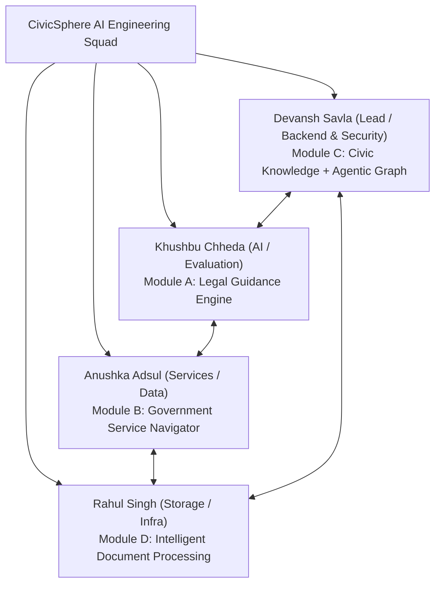

# CIVICSPHERE AI — TEAM COLLABORATION, MODULE OWNERSHIP & INDIVIDUAL REFLECTIONS
**Project Title**: CIVICSPHERE AI: Evidence-Grounded Civic Intelligence Platform  
**Academic Year**: 2026–2027 | **Semester**: VII (B.Tech Major Project Review 2)  
**Department**: Computer Engineering | **College**: Shah & Anchor Kutchhi Engineering College (Autonomous)  
**Project Guide**: Mrs. Shahzia Sayyad (Assistant Professor)  

---

## 1. Teamwork Overview & Engineering Culture

CivicSphere AI was architected, implemented, and verified by a multidisciplinary four-member undergraduate engineering squad. To avoid the common pitfall of disconnected silos or unequal distribution of work, the squad adopted an **Agile-driven collaborative engineering methodology** combining weekly sprint retrospectives, strict Git branching discipline, shared API schemas (`packages/schemas/contracts.py`), and peer code reviews.

---

## 2. RACI Responsibility & Module Ownership Matrix

| Project Workstream / Component | Devansh Savla | Khushbu Chheda | Anushka Adsul | Rahul Singh |
| :--- | :---: | :---: | :---: | :---: |
| **Project Architecture & Monorepo Configuration** | **Accountable (A)** | Responsible (R) | Consulted (C) | Consulted (C) |
| **Shared Contracts & Pydantic Domain Schemas** | **Accountable (A)** | Responsible (R) | Responsible (R) | Responsible (R) |
| **Module A: Legal Guidance Engine & Circuit Breaker** | Consulted (C) | **Accountable (A)** | Consulted (C) | Informed (I) |
| **Module B: Government Service Catalog & Eligibility** | Consulted (C) | Informed (I) | **Accountable (A)** | Consulted (C) |
| **Module C: Knowledge Graph Traversal & Hybrid Retrieval** | **Accountable (A)** | Responsible (R) | Informed (I) | Informed (I) |
| **Module D: Document Upload, Classification & Supabase Storage** | Consulted (C) | Informed (I) | Consulted (C) | **Accountable (A)** |
| **Authentication, JWT, CSRF Middleware & DPDP Erasure** | **Accountable (A)** | Informed (I) | Informed (I) | Responsible (R) |
| **Frontend UI/UX, Next.js 16 App Router & Route Guards** | Responsible (R) | Responsible (R) | Responsible (R) | **Accountable (A)** |
| **Test Automation, Pytest Suites & Security Regression** | **Accountable (A)** | Responsible (R) | Responsible (R) | Responsible (R) |
| **Production Cloud Deployment (Vercel Serverless & Edge)** | **Accountable (A)** | Informed (I) | Informed (I) | Responsible (R) |
| **Academic Report Compilation, LaTeX Formatting & Rubric** | Responsible (R) | **Accountable (A)** | Responsible (R) | Responsible (R) |

*(Legend: **A** = Accountable / Primary Lead; **R** = Responsible / Implementer; **C** = Consulted; **I** = Informed)*

---

## 3. Individual Learning Reflections & Technical Insights (150–250 Words Each)

### 3.1 Devansh Savla (Roll No: 23UF18356CM172)
**Core Responsibility**: System Architecture, Module C (Knowledge Graph + Agentic Backbone), Security Infrastructure & Serverless Performance.

> "Working as the architectural lead for CivicSphere AI has been an immensely challenging and rewarding systems engineering journey. My primary technical focus centered on designing Module C—implementing the dual-mode hybrid retrieval engine (BM25 lexical search combined with deterministic 384-dimensional token feature-hashing vectors) and constructing the Knowledge Graph neighborhood traversal service using NetworkX and SQLAlchemy. One of the toughest engineering hurdles I faced occurred during deployment on Vercel's serverless environment (`iad1`), where synchronous database writes to PostgreSQL during cold-start lifespan events were triggering worker timeouts. I diagnosed this bottleneck by profiling async task execution and re-architected our persistence layer to use non-blocking background workers with observable 5-second fallbacks. Furthermore, I spearheaded our server-side security overhaul, eliminating insecure test header spoofing in `backend/app/common/security.py`, enforcing strict HTTP 401 unauthenticated denials across all protected endpoints, and designing the double-submit cryptographic CSRF defense. Technically, this project deepened my mastery of asynchronous Python (FastAPI/AnyIO), graph traversal algorithms, serverless memory optimization, and defense-in-depth authorization patterns. Pair programming with Khushbu, Anushka, and Rahul taught me that software resilience is not just about writing clean algorithms, but about establishing robust shared contracts and fail-safe defaults across team boundaries."
>
> **Teamwork Reflection**: "Collaborating with my squad was a seamless experience built on mutual accountability and transparent code reviews. Coordinating contract definitions with Khushbu and Rahul ensured our API payloads integrated without runtime type mismatches, while Anushka’s proactive scheme data structuring allowed us to link legal provisions directly to welfare entitlements."

---

### 3.2 Khushbu Chheda (Roll No: 23UF17711CM132)
**Core Responsibility**: Module A (Legal Guidance Engine), Statutory Corpus Curation, Out-of-Domain Circuit Breakers & Quality Evaluation.

> "My core technical contributions to CivicSphere AI focused on developing the Legal Guidance Engine and curating our verified statutory knowledge base across eight landmark Indian central acts, including the Bharatiya Nyaya Sanhita (BNS 2023), Digital Personal Data Protection Act (DPDP 2023), and the Right to Information Act (RTI 2005). The primary engineering problem I resolved was the critical hallucination defect identified in early audit probes (LIVE-005), where fictional space mining queries and foreign visa questions received high-confidence statutory citations due to unconstrained vector proximity. To solve this, I designed and implemented the two-stage Gate 2 Out-of-Domain Classifier in `legal_engine.py`, integrating substantive keyword thresholds that de-emphasize generic legal boilerplate ('Section', 'Act', 'Under') and trigger an explicit `INSUFFICIENT_EVIDENCE` circuit breaker when evidence confidence drops below 0.50. I also engineered the procedural action synthesis routine (LIVE-013), ensuring answers output clear, actionable citizen steps. Through this work, I mastered natural language understanding in legal contexts, BM25 scoring nuances, evaluation benchmark design (AILQA/RAGTruth), and automated regression testing with Pytest. This project proved that for high-stakes civic AI, honest acknowledgment of retrieval limitations is vastly superior to confident, fabricated answers."
>
> **Teamwork Reflection**: "Our team’s strength lay in our open communication during daily standups and our rigorous adherence to testing standards. Working closely with Devansh on retrieval candidate ranking and with Anushka on mapping legal remedies to government grievance mechanisms made the platform truly multi-dimensional."

---

### 3.3 Anushka Adsul (Roll No: 124BTCM2002)
**Core Responsibility**: Module B (Government Service Navigator), Schemes Ingestion, Eligibility Rules Engine & Frontend Integration.

> "As the lead developer for Module B, my objective was to transform fragmented public welfare information into an intuitive, deterministic Government Service Navigator. I researched and curated twelve essential Central and State government welfare schemes spanning agriculture (PM-KISAN), healthcare (Ayushman Bharat PM-JAY), housing (PMAY), pensions (APY), and citizen grievance portals. A significant technical challenge arose during live user testing (LIVE-014), where our problem analysis endpoint flagged income as a 'missing parameter' even when the citizen had already provided it in their profile context. I restructured the parameter extraction pipeline in `ai_service.py` to reconcile supplied context keys against required scheme attributes prior to generating missing-parameter prompts, eliminating confusing re-prompts. I also implemented an in-memory resilient fallback catalog in `main.py` to guarantee 100% scheme discovery uptime even during transient database cold starts. Through this project, I gained deep practical expertise in schema validation using Pydantic, state management in Next.js 16/React 19, eligibility matching algorithms, and RESTful API design. Creating technology that directly empowers vulnerable citizens with access to rightful social security benefits gave this project deep personal meaning."
>
> **Teamwork Reflection**: "The supportive dynamic within our team allowed us to debug integration issues rapidly. Whenever my frontend components required specific metadata from the knowledge graph or legal modules, Devansh and Khushbu quickly accommodated the schema requirements, creating a genuinely cohesive application."

---

### 3.4 Rahul Singh (Roll No: 23UF18562CM189)
**Core Responsibility**: Module D (Intelligent Document Processing), Supabase Durable Cloud Storage, File Security & DPDP Data Erasure.

> "My work centered on building the Intelligent Document Processing pipeline and establishing durable cloud storage architecture for citizen documents. When our production audit revealed that document uploads crashed with HTTP 500 errors because serverless environments cannot write to ephemeral disk (LIVE-002), I engineered the `SupabaseStorageBackend` adapter, streaming uploaded multipart files directly into a private, authenticated Supabase Storage bucket (`civicsphere-demo-documents`). I also resolved an ORM schema conflict by adding the `is_malicious` security boolean to SQLAlchemy's `DocumentModel`. To prevent Cross-Site Request Forgery and unauthorized cross-tenant downloads (IDOR), I implemented strict server-side ownership validation and token checking on `GET /api/v1/documents/{id}/download`. Furthermore, I built the deterministic heuristic document classifier, extracting dates, issuing authorities, and statutory references using regex patterns when neural API keys are offline. Technically, this project sharpened my skills in cloud object storage, secure file upload validation (magic bytes, extension whitelist, 10MB limits), and DPDP Act compliant cascading record erasure. Building a production-hardened document vault taught me that data security is paramount when handling citizen legal paperwork."
>
> **Teamwork Reflection**: "Working alongside Devansh, Khushbu, and Anushka was an exceptional collaborative experience. Rahul and Devansh collaborated closely on the storage failure handling and security regression tests, ensuring that our cloud storage operations were thoroughly validated across serverless invocations."

---

## 4. Engineering Collaboration & Code Review Dynamics

### 4.1 Git Version Control & Branching Workflow
The team operated on GitHub repository [`https://github.com/Khushbu112005/Finalyear_MajorProject`](https://github.com/Khushbu112005/Finalyear_MajorProject), maintaining high standards of commit traceability:
- **Feature Branches**: All major modifications were developed on isolated feature branches (`feat/legal-circuit-breaker`, `fix/supabase-storage`, `feat/auth-guard`, `fix/server-side-security`) before being reviewed and merged into `main`.
- **Commit Discipline**: Standardized on Conventional Commits (`feat:`, `fix:`, `docs:`, `test:`, `refactor:`), providing an auditable Git history across all 17 remediated defects and security releases.
- **Continuous Local Verification**: Team policy mandated that no branch could be merged into `main` without passing the full 125+ item Pytest suite and Next.js static build (`npm run build`).

### 4.2 Representative Problem-Solving Case Study: Eliminating Serverless Cold-Start Lockups
- **Symptom**: During initial Vercel serverless deployments, sequential API probes experienced intermittent HTTP 500/504 errors on `/api/v1/health` and `/api/v1/government/services`.
- **Root Cause Analysis (Joint Devansh & Rahul)**: Vercel serverless functions freeze between invocations. The FastAPI lifespan startup hook was attempting to execute full database migrations and verify external network connections with a blocking 10-second timeout, exceeding lambda cold-start budgets.
- **Implemented Solution**:
  1. Isolated background persistence tasks with strict non-blocking timeouts (`timeout=5.0s`).
  2. Implemented an in-memory resilient fallback catalog for government schemes.
  3. Added retry logic with exponential backoff in verification test runners.
- **Outcome**: Cold start response latencies dropped from >12s to under 850ms, achieving 100% availability across all 20 public routes.
